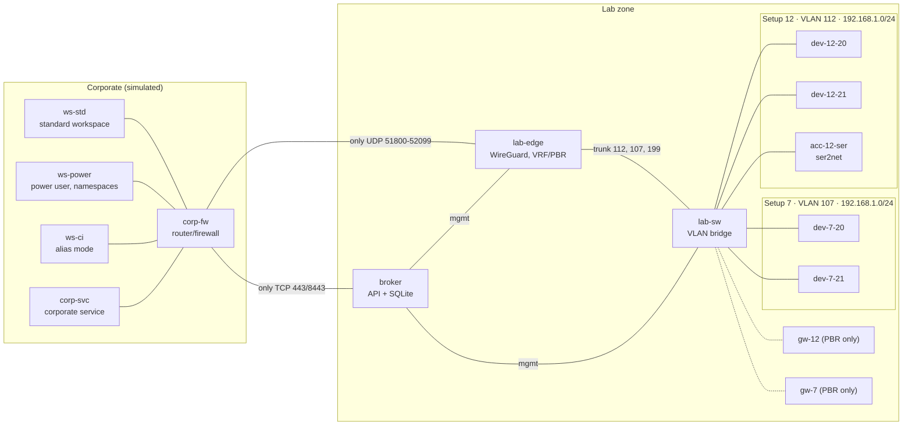

# Concept: Docker-based test environment for hardware-pool access

*Translated from the German original [concept.de.md](concept.de.md) (18 Nov 2026), which supplements the document
"Concept: access from vSphere workspaces to the hardware pool (Proxmox)". This English version is the one that is maintained.*

> **What changed since the concept was written.** The sections below are the original concept. Where the lab now
> works differently, the decision and its evidence are recorded in [decisions/](decisions/README.md):
>
> | Concept said | Lab does now | See |
> |---|---|---|
> | one lab switch `lab-sw`, devices `dev-<setup>-<ip>` with a fixed setup | Lancom-like aggregation switch `lab-agg` + system switches `lab-sys1/2`; devices `sys1-dev1` … are grouped into setups dynamically | [common.md](../containerlab/vlabzone/docs/common.md) |
> | edge modes VRF and PBR | in addition **hybrid** (one WireGuard port, setups in edge VRFs) – the recommended mode | [ADR 0003](decisions/0003-one-corporate-port-edge-mode.md) |
> | tunnel addresses `10.250.<user>.<setup>` | `10.250.<setup>.<user>` | [ADR 0002](decisions/0002-tunnel-addresses-setup-first.md) |
> | Linux edge only | every lab also runs with the **MikroTik** (RouterOS CHR) as edge, driven over REST (E27) | [ADR 0004](decisions/0004-routeros-edge-driver-rest.md) |
> | serial access instance `acc-12-ser` per setup, USB only optional | one shared **Moxa NPort 5600** and one shared **AnywhereUSB 24 Plus** in an appliance VLAN behind the edge (E14, E26) | [ADR 0005](decisions/0005-appliance-placement.md), [0006](decisions/0006-nport-operation-mode.md), [0007](decisions/0007-usb-access-enforced-by-hub-groups.md) |
> | repository `hwpool-testenv/` | this repository; the lab lives in `containerlab/vlabzone/` | [README](../README.md) |
>
> Status of every experiment: [experiments.md](experiments.md). What comes next: [roadmap.md](roadmap.md).

---

## 1. Purpose and goals

The test environment reproduces the network and access architecture **entirely virtually on a single Linux host**,
before vSphere, Proxmox, the corporate network and the lab switches are touched.

Goals:

1. **Prove feasibility:** overlapping setup networks, original IPs, parallel setups per user, isolation.
2. **Compare variants:** one VRF per setup versus policy-based routing (PBR), and original-IP versus alias mode.
3. **Provoke failure modes:** MTU, UDP timeouts, misconfiguration, spoofing attempts, failure of the lab edge.
4. **Develop the automation:** broker API, `lab-agent` and edge/switch configuration as a prototype that can later run against the real environment.
5. **Reproducibility:** the environment can be built, reset and tested automatically with one command.

---

## 2. Scope

| Reproduced | **Not** reproduced |
|---|---|
| Corporate network as router/firewall with the one-time allowance | vSphere, VDI broker, real Windows clients |
| Workspace VMs as Linux containers (standard, power user, CI) | Proxmox API, Proxmox SDN, resource mappings |
| Lab edge with WireGuard, VRF or PBR, NAT, firewall | USB and PCIe passthrough (only simulated as a service) |
| Lab switch with VLANs (access ports, trunk) | Vendor-specific switch APIs |
| Setups with overlapping networks and simulated devices | Real device firmware, vendor software |
| Serial device via `ser2net` | AD/Kerberos (optional, in a later stage) |
| Broker (prototype) and `lab-agent` | Production-grade high availability |

Section 9 sketches a follow-up stage for the points not covered (nested Proxmox, Windows VM).

---

## 3. Technical basis

### 3.1 Tools

- **Docker Engine** as container runtime.
- **containerlab** as topology tool (recommended). It builds on Docker, connects containers with point-to-point veth
  links and so bypasses Docker IPAM. This is essential, because Docker **does not allow two networks with overlapping
  subnets**, and in bridge networks it may filter traffic with "foreign" addresses.
- Own images based on Debian (slim) with `iproute2`, `wireguard-tools`, `nftables`, `iptables`, `tcpdump`, `openssh`,
  `socat`, `ser2net`, `iperf3`, `curl`, `jq`, `python3`.

**Alternative without containerlab:** Docker Compose is possible, but only with placeholder subnets per setup network,
re-addressing in the entrypoints afterwards and without `internal: true`. This is more error-prone and is mentioned
here only as a fallback.

### 3.2 Host requirements

- Linux host or Linux VM (e.g. Debian 12/13, Ubuntu 24.04), **not** Docker Desktop on macOS/Windows, because its VM
  kernel doesn't provide all modules.
- Kernel ≥ 5.6 with the modules `wireguard`, `vrf`, `8021q`, `bridge`:

```bash
sudo modprobe wireguard vrf 8021q bridge
echo -e "wireguard\nvrf\n8021q\nbridge" | sudo tee /etc/modules-load.d/hwpool-lab.conf
```

- Resources: 4 vCPU, 8 GB RAM and 20 GB disk are enough for the base topology. For scale tests (E15) 8 vCPU and 16 GB RAM.

### 3.3 Security note

containerlab starts Linux nodes **privileged** by default. This is needed for network namespaces, VRFs and WireGuard,
but it makes the environment a pure test environment. It belongs on a dedicated host or a dedicated VM.

---

## 4. Topology

### 4.1 Overview



### 4.2 Nodes

| Node | Role | Image | Notes |
|---|---|---|---|
| `corp-fw` | Simulated corporate network: routing between the workspace network, a corporate service and the lab. Implements **only** the one-time allowance. | `hwpool/router` | nftables; `tc netem` for latency, packet loss and MTU experiments; short UDP timeouts configurable |
| `corp-svc` | Corporate service (e.g. a "file server") to test network collisions | `hwpool/device` | address freely selectable, e.g. also in `192.168.1.0/24` |
| `ws-std` | Standard workspace with `wg-lab` | `hwpool/workspace` | `lab-agent`, desktop mode |
| `ws-power` | Power-user workspace | `hwpool/workspace` | `lab enter <setup>`, one namespace per setup |
| `ws-ci` | Automation/CI | `hwpool/workspace` | alias mode `10.200.N.x` |
| `lab-edge` | Lab edge | `hwpool/edge` | `EDGE_MODE=vrf` or `EDGE_MODE=pbr`; trunk to `lab-sw` |
| `broker` | Broker prototype | `hwpool/broker` | REST API, SQLite, controls edge and switch over SSH |
| `lab-sw` | Lab switch | `hwpool/router` | Linux bridge with `vlan_filtering`, one access port per device, trunk to the edge |
| `dev-<setup>-<ip>` | Simulated device | `hwpool/device` | SSH, HTTP status page, syslog; reports setup and device name |
| `acc-12-ser` | "Serial" access instance | `hwpool/serial` | `ser2net` (RFC 2217) with a simulated console |
| `gw-12`, `gw-7` | Setup gateways (PBR variant only) | `hwpool/router` | one port each in VLAN 199 (transfer) and in the setup VLAN |
| `samba-ad` *(optional)* | AD/Kerberos for SSO tests | `hwpool/samba-ad` | stage 4 at the earliest |

### 4.3 Address plan of the test environment

| Segment | Network | Addresses |
|---|---|---|
| Workspace network (corporate) | `10.20.10.0/24` | `corp-fw` .1, `ws-std` .11, `ws-power` .12, `ws-ci` .13 |
| Corporate services | `10.20.20.0/24` | `corp-fw` .1, `corp-svc` .10 |
| Transfer corporate → lab edge | `10.20.99.0/30` | `corp-fw` .1, `lab-edge` .2 |
| Transfer corporate → broker | `10.20.98.0/30` | `corp-fw` .1, `broker` .2 |
| Lab management | `10.198.0.0/24` | `broker` .1, `lab-edge` .2, `lab-sw` .3 |
| WireGuard tunnels | `10.250.0.0/16` | edge `10.250.0.1`, contexts `10.250.<setup>.<user>` (until 20 Nov 2026: `<user>.<setup>`; reason: [ADR 0002](decisions/0002-tunnel-addresses-setup-first.md)) |
| Lab transfer (PBR only) | `10.199.0.0/24`, VLAN 199 | edge .1, `gw-N` .N |
| Alias networks | `10.200.0.0/16` | setup N → `10.200.N.0/24` |
| Setup 12 | `192.168.1.0/24`, VLAN 112 | edge/GW .254, `dev-12-20` .20, `dev-12-21` .21, `acc-12-ser` .30 |
| Setup 7 | `192.168.1.0/24`, VLAN 107 | edge/GW .254, `dev-7-20` .20, `dev-7-21` .21 |

The simulated devices deliberately get a **wrong default gateway** (`192.168.1.1`), to show that access still works
thanks to MASQUERADE.

Which of these addresses can be changed in one place today: [evaluating.md §4](evaluating.md#4-address-layout).

### 4.4 Management network and bypass

containerlab also attaches every node to a management network (a Docker bridge). Through it, workspaces and the lab
edge would be connected **directly**, bypassing the simulated corporate firewall. Therefore:

- Nodes that don't need management access at runtime get `network-mode: none` (images are built beforehand).
- Where that isn't possible, an nft rule in the node drops all traffic over `eth0` except from the host.
- Experiment E05 explicitly checks that no bypass exists.

---

## 5. Building blocks in detail

### 5.1 Repository structure

The structure as planned (today's layout: [README](../README.md#repository-map)):

```
hwpool-testenv/
├── Makefile                  # build, up, down, reset, test, exp-E01 …
├── topology/
│   └── hwpool.clab.yml
├── images/
│   ├── base/Dockerfile
│   ├── router/               # corp-fw, lab-sw, gw-N
│   ├── edge/                 # entrypoint, edge-vrf.sh, edge-pbr.sh, edge-alias.sh
│   ├── workspace/            # lab-agent, lab (CLI), lab-enter
│   ├── device/               # sshd, ident-http.py, rsyslog
│   ├── serial/               # ser2net.yaml, fake-console.sh
│   └── broker/               # app.py, schema.sql, drivers/edge.py, drivers/switch.py
├── config/
│   ├── setups.yaml           # setups, VLANs, networks, ports, devices
│   ├── corp-fw.nft           # one-time allowance
│   └── users.yaml            # test users and tokens
├── tests/
│   ├── conftest.py
│   └── test_eXX_*.py         # one test module per experiment
└── results/                  # measurement protocols, pcap files
```

### 5.2 Topology (excerpt)

```yaml
name: hwpool
topology:
  defaults:
    kind: linux
  nodes:
    corp-fw:   { image: hwpool/router:latest,    network-mode: none }
    ws-std:    { image: hwpool/workspace:latest, network-mode: none, env: { WS_MODE: desktop } }
    ws-power:  { image: hwpool/workspace:latest, network-mode: none, env: { WS_MODE: power } }
    ws-ci:     { image: hwpool/workspace:latest, network-mode: none, env: { WS_MODE: alias } }
    lab-edge:  { image: hwpool/edge:latest,      network-mode: none, env: { EDGE_MODE: vrf } }
    broker:    { image: hwpool/broker:latest }
    lab-sw:    { image: hwpool/router:latest,    network-mode: none, env: { ROLE: switch } }
    dev-12-20: { image: hwpool/device:latest,    network-mode: none, env: { SETUP: "12", IP: 192.168.1.20/24 } }
    dev-7-20:  { image: hwpool/device:latest,    network-mode: none, env: { SETUP: "7",  IP: 192.168.1.20/24 } }
  links:
    - endpoints: ["ws-std:eth1",    "corp-fw:eth1"]
    - endpoints: ["ws-power:eth1",  "corp-fw:eth2"]
    - endpoints: ["ws-ci:eth1",     "corp-fw:eth3"]
    - endpoints: ["corp-fw:eth10",  "lab-edge:eth1"]
    - endpoints: ["corp-fw:eth11",  "broker:eth1"]
    - endpoints: ["lab-edge:eth2",  "lab-sw:eth1"]     # trunk
    - endpoints: ["dev-12-20:eth1", "lab-sw:eth11"]    # access VLAN 112
    - endpoints: ["dev-7-20:eth1",  "lab-sw:eth21"]    # access VLAN 107
```

Whether the containerlab version in use supports `network-mode: none` for all nodes is checked while building.
Otherwise the nft lock from section 4.4 applies. The workspaces additionally need a layer-2 connection to each other
(all in `10.20.10.0/24`). For that, `corp-fw` gets an internal bridge over `eth1`–`eth3`.

### 5.3 Lab switch

```bash
ip link add br0 type bridge vlan_filtering 1 && ip link set br0 up
for p in eth1 eth11 eth12 eth13 eth21 eth22; do ip link set $p master br0 up; done

# trunk to the lab edge
bridge vlan add dev eth1 vid 112
bridge vlan add dev eth1 vid 107
bridge vlan add dev eth1 vid 199

# access ports
sw-port eth11 112   # dev-12-20
sw-port eth21 107   # dev-7-20
```

`sw-port` is a small script (remove VLAN 1, set the wanted VLAN as `pvid untagged`). The broker calls it over SSH.
This corresponds to the later Ansible automation of the real switches.

### 5.4 Simulated device

Every device returns a **unique identity**, so tests can check where a packet ended up:

- hostname `setup12-dev20`, SSH banner and prompt with the setup number
- HTTP on port 80: `{"setup": 12, "device": "dev-12-20", "ip": "192.168.1.20", "peer": "<sender IP>"}`
- syslog with the source IP of every SSH login (shows the MASQUERADE effect)
- optional services: `iperf3 -s` for throughput, a "config" file with the device's own IP

### 5.5 Serial access instance

`acc-12-ser` creates a virtual serial device with `socat`, behind which a script plays a simple device console
(`login:`, `show version`, `reboot`). `ser2net` serves it over RFC 2217 on port 3001. The test client is `socat` or
`pyserial` with `rfc2217://192.168.1.30:3001`.

> **Implemented differently (stage 2, step 13):** in the real environment the serial consoles are connected to a
> Moxa NPort 5600 and the USB devices to a Digi AnywhereUSB 24 Plus – one shared device each for all setups. In the
> lab they are `nport1` (RFC 2217, port 4000+K) and `ausb1` (USB/IP as a stand-in, one TCP port) in their own VLAN 197
> behind the edge, without NAT. Serial is separated by the edge (per setup only the console ports of its devices),
> USB by the hub (groups per setup, members per booking). Details:
> [consoles-usb.md](../containerlab/vlabzone/docs/consoles-usb.md) (E14, E26).

### 5.6 Lab edge

An entrypoint reads `setups.yaml` and builds the selected mode:

- **`EDGE_MODE=vrf`:** per setup a VRF, a VLAN subinterface on the trunk, a WireGuard interface with its own port and
  MASQUERADE. As in the concept document (section 5.4).
- **`EDGE_MODE=pbr`:** one WireGuard interface `wg0` on port 51820, VLAN 199 to the lab transfer, `ip rule` and a
  table per context. The setup gateways `gw-N` do the MASQUERADE.
- **Alias extension** (in both modes): NETMAP from `10.200.N.0/24` to the setup network for the contexts of `ws-ci`.

Peers are **not** created at startup, only by the broker. A restart of the edge therefore produces exactly the state
the broker has to restore (E16).

### 5.7 Broker prototype

Python (FastAPI or Flask) with SQLite. Authentication first with a token per test user, optionally Kerberos against
`samba-ad` in stage 4.

| Endpoint | Function |
|---|---|
| `POST /api/setups` / `DELETE /api/setups/{id}` | create or tear down a setup: switch ports, edge VRF or gateway |
| `POST /api/bookings` | booking (user, setup, period, mode) including conflict check |
| `POST /api/contexts` | the agent registers its public key, the broker creates the peer and returns the configuration |
| `DELETE /api/contexts/{id}` | deregister a context |
| `POST /api/bookings/{id}/revoke` | immediate revocation |
| `GET /api/audit` | who had which setup when |
| internal reconcile loop | compare desired state (DB) with actual state (edge: `wg show dump`, `ip rule`) |

The **drivers** for edge and switch are encapsulated and replaceable, so the same broker can later run against the
real environment (Proxmox API, switch Ansible).

### 5.8 Workspace and lab-agent

- `lab connect <setup>`, `lab disconnect <setup>`, `lab list`, `lab enter <setup>`, as described in the concept.
- The agent generates keys locally and talks to the broker over HTTPS through `corp-fw`.
- In `ws-power`, namespaces run with their own prompt `[setupNN]`.

### 5.9 Test automation

- **pytest** as framework. Helper functions run commands in the nodes with `docker exec` (or `ip netns exec` in the
  namespace).
- Every experiment is a test module with clear **success criteria** (assert) and writes measurements to `results/`.
- `make reset` returns the environment to its initial state within seconds (`containerlab destroy` + `deploy`).
- When needed, `tcpdump` captures on `corp-fw` and `lab-edge` (`results/*.pcap`) – e.g. as evidence that only UDP is
  visible in the corporate network.

---

## 6. Experiments

The experiments are grouped by topic. Each experiment answers a concrete question from the concept. Current status
per lab: [experiments.md](experiments.md).

### 6.1 Basic function and constraints

| ID | Question | Procedure | Success criterion |
|---|---|---|---|
| **E01** | Is the one-time corporate allowance enough? | `corp-fw` only allows UDP 51800–52099 and TCP 443 towards the lab. `ws-std` books setup 12 and opens `http://192.168.1.20`. | Access works; the capture on `corp-fw` shows only encrypted UDP or TLS traffic. |
| **E02** | Are setups with the same network cleanly separated? | User A books setup 12, user B setup 7. Both open `192.168.1.20`. | A gets `setup: 12`, B gets `setup: 7`. No packet ends up in the wrong setup (pcap on `lab-sw`). |
| **E03** | Do the original IPs also work for SSH and logs? | SSH to `192.168.1.20`, read the device's config file and syslog. | Prompt, configuration and banner show `192.168.1.20` and the setup number. Syslog shows `192.168.1.254` as sender (documented behaviour). |
| **E04** | Does access work despite a wrong gateway on the devices? | Devices have `192.168.1.1` as default gateway (doesn't exist). Test with and without MASQUERADE. | With MASQUERADE: access works. Without: no answer. This proves it is needed. |

### 6.2 Isolation and security

| ID | Question | Procedure | Success criterion |
|---|---|---|---|
| **E05** | Are there ways around the architecture? | From workspaces: address the lab edge, switch and devices directly (without tunnel), also over the management network. From a setup: address the corporate network, other setups and the internet. | All attempts fail. No new connections out of setups are possible. |
| **E06** | Can a user fake someone else's tunnel IP? | Set the tunnel IP of another context in `ws-std`, or send packets with a forged sender into the tunnel. | The lab edge drops the packets (cryptokey routing); access to the foreign setup isn't possible. |
| **E07** | Can someone get into a setup without a booking or after it expired? | Access without booking; let a booking with a short duration expire. | Without booking no peer, no access. After expiry the broker removes the peer automatically. |
| **E08** | How fast does a revocation take effect, also with a running session? | Running SSH session and continuous ping, then `revoke`. | Traffic ends within ≤ 1 s after the peer is removed. The time is measured and recorded. |
| **E09** | Does the namespace isolate the power-user context from the corporate network? | In namespace `setup12`, address `corp-svc` and setup 7. | Only setup 12 is reachable. |

### 6.3 Variants and access modes

| ID | Question | Procedure | Success criterion / measure |
|---|---|---|---|
| **E10** | VRF or PBR? | All tests from 6.1 and 6.2 in both modes (`EDGE_MODE=vrf` and `pbr`). In addition, deliberate misconfigurations: missing `ip rule`, wrong table, peer in the wrong VRF. | Both modes pass the functional tests. Recorded: number of configuration steps per booking, effect of the misconfiguration (fail-closed or wrong setup?), readability when debugging. |
| **E11** | Parallel setups with the same network for power users | In `ws-power`: `lab enter 12` and `lab enter 7` in parallel; SSH, HTTP, `iperf3` in each. | Every session ends up in the right setup, also under load. |
| **E12** | Conflict check of the broker | A standard user books two setups with the same network; a setup network collides with `corp-svc` (e.g. `corp-svc` in `192.168.1.0/24`). | The broker refuses the first case in desktop mode or suggests namespace or alias. In the second case it falls back to alias mode. Without the check: demonstrable loss of corporate access (negative test). |
| **E13** | Alias mode for CI | `ws-ci` accesses `10.200.12.20` and `10.200.7.20` in parallel. | Both reachable, correct identity. Protocols with IPs in the payload (e.g. active FTP) are documented as a known limit. |
| **E14** | Serial device through the setup | RFC 2217 client on `192.168.1.30:3001`, baud-rate change, console commands. | Console usable, the baud-rate change arrives at `ser2net`. |

### 6.4 Operations, robustness and performance

| ID | Question | Procedure | Success criterion / measure |
|---|---|---|---|
| **E15** | Which MTU is right? | Lower the MTU on the path `corp-fw` → `lab-edge` to 1450 or 1400 (simulates extra encapsulation). `scp` of large files, HTTP downloads. | Find the WireGuard MTU at which transfers hang. Result: recommendation for MTU or MSS clamping. |
| **E16** | Is `PersistentKeepalive` needed? | Set the UDP timeout on `corp-fw` to 30 s. Let the tunnel idle, then create traffic from the lab side (e.g. syslog sent back). | Without keepalive the return path breaks, with `PersistentKeepalive = 25` it doesn't. |
| **E17** | Behaviour with latency and packet loss | `tc netem` on `corp-fw`: 20/50/100 ms latency, 1/5 % loss. SSH use, `iperf3`, serial console. | Measurements for throughput and response time. Assessment of when work becomes uncomfortable. |
| **E18** | Recovery after a lab-edge failure | Restart the lab edge or recreate the container. | The reconcile loop restores all peers and rules. Measured: time until fully restored. |
| **E19** | Floating VDI | Destroy and recreate `ws-std`, simulate a "login". | The agent generates new keys, the broker replaces the old peer. The old key is useless afterwards. |
| **E20** | Move a device between setups | The broker moves `dev-12-21` from VLAN 112 to 107 with `sw-port`. | The device is then only reachable in setup 7. A conflict with the same IP in the target setup is detected by the broker. |
| **E21** | Scale | A script creates 50 setups and 200 contexts (devices as lightweight containers or edge-side only). | Time to create setups and bookings, memory of the edge, throughput with many peers. Comparison VRF vs PBR. |
| **E22** | Tunnel throughput | `iperf3` from workspace to device, single and in parallel. | Throughput per context and in total, CPU load on the lab edge. Basis for sizing. |

### 6.5 Optional extensions

| ID | Question | Procedure |
|---|---|---|
| **E23** | SSO instead of tokens | `samba-ad` as AD DC, broker with Kerberos/Negotiate, agent with `kinit`. |
| **E24** | Windows access path | Setup-shell container in setup 12 with SSH and SOCKS (`ssh -D`); test from `ws-power` with a browser profile or `curl --socks5`. Optionally a real Windows VM attached to the workspace network over a host bridge. |
| **E25** | DNS per setup | DNS service on the edge per VRF with names like `dut20.setup12.lab`; `resolv.conf` per namespace. |
| **E26** | USB over IP (limited) | `usbip` with a virtual device (e.g. `dummy_hcd`/gadget on the host). Only if the host kernel provides the modules. Otherwise postpone to real hardware. |

*(Added later: **E27** – the MikroTik/RouterOS edge behaves like the Linux edge; see [experiments.md](experiments.md).)*

---

## 7. Stages

| Stage | Content | Experiments |
|---|---|---|
| **0 – Host** | Linux host, kernel modules, Docker, containerlab, base images | – |
| **1 – Network skeleton** | `corp-fw`, `lab-edge` (VRF, peers by script), `lab-sw`, devices in setups 12 and 7, workspaces with static WireGuard configuration | E01–E06, E09 |
| **2 – Variants** | PBR mode with gateways, namespaces in `ws-power`, alias mode, serial device | E10, E11, E13, E14 |
| **3 – Broker and agent** | broker API, reconcile loop, `lab-agent`, conflict check, audit, switch control | E07, E08, E12, E18–E20 |
| **4 – Operations and load** | netem, MTU, keepalive, scale, throughput; optionally AD and the Windows path | E15–E17, E21–E26 |

At the end of every stage the complete test suite of the previous stages runs again (regression test). Progress:
[roadmap.md](roadmap.md).

---

## 8. Recording results

For every experiment a short protocol is stored in `results/`:

| Field | Content |
|---|---|
| Experiment | ID, title, date, edge mode |
| Setup | deviations from the standard topology (e.g. MTU, netem) |
| Result | passed / failed, measurements |
| Observations | anomalies, failure modes, captures |
| Consequence for the concept | e.g. "MTU 1380 as default", "PBR not fail-closed on misconfiguration" |

The consequences flow back into the concept document, especially into its open points (section 7 of the concept).
In this repository they are recorded as [decisions](decisions/README.md).

---

## 9. Limits and follow-up stage

The Docker environment proves the **network and access logic**. It does not prove:

- the Proxmox SDN API, resource mappings and real passthrough
- the behaviour of real lab switches and their automation
- vSphere/VDI integration and Windows clients with the WireGuard service
- the real-time behaviour of real USB and PCIe devices

Proposal for a **follow-up stage** on the same hardware or a test host:

1. **Nested Proxmox** (Proxmox VM with nested virtualization): create setups via the real Proxmox SDN API, access
   instances as LXC.
2. **Windows VM** in the workspace network: `lab-agent` as a Windows service, WireGuard for Windows, setup shell and
   SOCKS path.
3. **One real lab switch and one or two real devices** (USB programmer, serial console) for the broker's drivers and
   latency measurements.

The broker and agent from the Docker environment are reused. Only the drivers for edge, switch and Proxmox are replaced.
