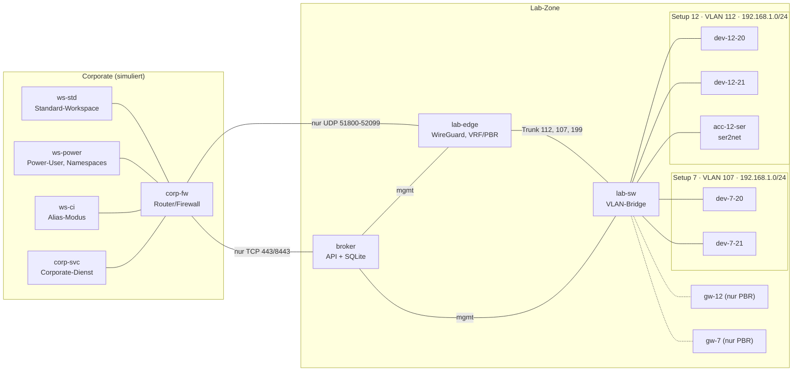

# Konzeptvorschlag: Docker-basierte Testumgebung für den Hardware-Pool-Zugriff

*Stand: 18.11.2026 – Ergänzung zum Dokument „Konzept: Zugriff aus vSphere-Arbeitsumgebungen auf den Hardware-Pool (Proxmox)"*

---

## 1. Zweck und Ziele

Die Testumgebung soll die Netz- und Zugriffsarchitektur **vollständig virtuell auf einem einzelnen Linux-Host** nachbilden, bevor vSphere, Proxmox, Corporate-Netz und Lab-Switches angefasst werden.

Ziele:

1. **Machbarkeit belegen:** Überlappende Setup-Netze, Original-IPs, parallele Setups pro Benutzer, Isolation.
2. **Varianten vergleichen:** VRF pro Setup gegen Policy-Based Routing (PBR) sowie Original-IP- gegen Alias-Modus.
3. **Fehlerbilder provozieren:** MTU, UDP-Timeouts, Fehlkonfiguration, Spoofing-Versuche, Ausfall des Lab-Edge.
4. **Automatisierung entwickeln:** Broker-API, `lab-agent` und Edge-/Switch-Konfiguration als Prototyp, der später gegen die echte Umgebung laufen kann.
5. **Reproduzierbarkeit:** Die Umgebung lässt sich per Befehl aufbauen, zurücksetzen und automatisiert testen.

---

## 2. Abgrenzung

| Wird nachgebildet | Wird **nicht** nachgebildet |
|---|---|
| Corporate-Netz als Router/Firewall mit der einmaligen Freigabe | vSphere, VDI-Broker, echte Windows-Clients |
| Workspace-VMs als Linux-Container (Standard, Power-User, CI) | Proxmox-API, Proxmox-SDN, Resource Mappings |
| Lab-Edge mit WireGuard, VRF bzw. PBR, NAT, Firewall | USB- und PCIe-Passthrough (nur als Dienst simuliert) |
| Lab-Switch mit VLANs (Access-Ports, Trunk) | Hersteller-spezifische Switch-APIs |
| Setups mit überlappenden Netzen und simulierten Geräten | Echte Gerätefirmware, Herstellersoftware |
| Serielles Gerät via `ser2net` | AD/Kerberos (optional in einer späteren Stufe) |
| Broker (Prototyp) und `lab-agent` | Produktionsreife Hochverfügbarkeit |

Für die nicht abgedeckten Punkte wird in Abschnitt 9 eine Folgestufe skizziert (nested Proxmox, Windows-VM).

---

## 3. Technische Basis

### 3.1 Werkzeuge

- **Docker Engine** als Container-Laufzeit.
- **containerlab** als Topologie-Werkzeug (empfohlen). Es baut auf Docker auf, verbindet Container über Punkt-zu-Punkt-veth-Links und umgeht damit die Docker-IPAM. Das ist entscheidend, weil Docker **keine zwei Netzwerke mit überlappenden Subnetzen** zulässt und in Bridge-Netzen Verkehr mit „fremden" Adressen filtern kann.
- Eigene Images auf Basis von Debian (slim) mit `iproute2`, `wireguard-tools`, `nftables`, `iptables`, `tcpdump`, `openssh`, `socat`, `ser2net`, `iperf3`, `curl`, `jq`, `python3`.

**Alternative ohne containerlab:** Docker Compose ist möglich, dann aber mit Platzhalter-Subnetzen pro Setup-Netz, nachträglicher Umadressierung in den Entrypoints und ohne `internal: true`. Das ist fehleranfälliger und wird hier nur als Fallback genannt.

### 3.2 Host-Voraussetzungen

- Linux-Host oder Linux-VM (z. B. Debian 12/13, Ubuntu 24.04), **kein** Docker Desktop auf macOS/Windows, da dessen VM-Kernel nicht alle Module bereitstellt.
- Kernel ≥ 5.6 mit den Modulen `wireguard`, `vrf`, `8021q`, `bridge`:

```bash
sudo modprobe wireguard vrf 8021q bridge
echo -e "wireguard\nvrf\n8021q\nbridge" | sudo tee /etc/modules-load.d/hwpool-lab.conf
```

- Ressourcen: 4 vCPU, 8 GB RAM und 20 GB Disk reichen für die Basistopologie. Für Skalierungstests (E15) 8 vCPU und 16 GB RAM.

### 3.3 Sicherheitshinweis

containerlab startet Linux-Knoten standardmäßig **privilegiert**. Das ist für Netzwerk-Namespaces, VRFs und WireGuard nötig, macht die Umgebung aber zu einer reinen Testumgebung. Sie gehört auf einen dedizierten Host bzw. eine dedizierte VM.

---

## 4. Topologie

### 4.1 Übersicht



### 4.2 Knoten

| Knoten | Rolle | Image | Besonderheiten |
|---|---|---|---|
| `corp-fw` | Simuliertes Corporate-Netz: Routing zwischen Workspace-Netz, Corporate-Dienst und Lab. Setzt **nur** die einmalige Freigabe um. | `hwpool/router` | nftables; `tc netem` für Latenz, Paketverlust und MTU-Experimente; kurze UDP-Timeouts einstellbar |
| `corp-svc` | Corporate-Dienst (z. B. „Fileserver"), um Netzkollisionen zu testen | `hwpool/device` | Adresse frei wählbar, z. B. auch in `192.168.1.0/24` |
| `ws-std` | Standard-Workspace mit `wg-lab` | `hwpool/workspace` | `lab-agent`, Desktop-Modus |
| `ws-power` | Power-User-Workspace | `hwpool/workspace` | `lab enter <setup>`, Namespace pro Setup |
| `ws-ci` | Automatisierung/CI | `hwpool/workspace` | Alias-Modus `10.200.N.x` |
| `lab-edge` | Lab-Edge | `hwpool/edge` | `EDGE_MODE=vrf` oder `EDGE_MODE=pbr`; Trunk zu `lab-sw` |
| `broker` | Broker-Prototyp | `hwpool/broker` | REST-API, SQLite, steuert Edge und Switch per SSH |
| `lab-sw` | Lab-Switch | `hwpool/router` | Linux-Bridge mit `vlan_filtering`, ein Access-Port pro Gerät, Trunk zum Edge |
| `dev-<setup>-<ip>` | Simuliertes Gerät | `hwpool/device` | SSH, HTTP-Statusseite, Syslog; meldet Setup und Gerätenamen |
| `acc-12-ser` | Access-Instanz „seriell" | `hwpool/serial` | `ser2net` (RFC 2217) mit simulierter Konsole |
| `gw-12`, `gw-7` | Setup-Gateways (nur PBR-Variante) | `hwpool/router` | Je ein Port in VLAN 199 (Transfer) und im Setup-VLAN |
| `samba-ad` *(optional)* | AD/Kerberos für SSO-Tests | `hwpool/samba-ad` | Erst ab Stufe 4 |

### 4.3 Adressplan der Testumgebung

| Segment | Netz | Adressen |
|---|---|---|
| Workspace-Netz (Corporate) | `10.20.10.0/24` | `corp-fw` .1, `ws-std` .11, `ws-power` .12, `ws-ci` .13 |
| Corporate-Dienste | `10.20.20.0/24` | `corp-fw` .1, `corp-svc` .10 |
| Transfer Corporate → Lab-Edge | `10.20.99.0/30` | `corp-fw` .1, `lab-edge` .2 |
| Transfer Corporate → Broker | `10.20.98.0/30` | `corp-fw` .1, `broker` .2 |
| Lab-Management | `10.198.0.0/24` | `broker` .1, `lab-edge` .2, `lab-sw` .3 |
| WireGuard-Tunnel | `10.250.0.0/16` | Edge `10.250.0.1`, Kontexte `10.250.<setup>.<user>` (bis 2026-11-20: `<user>.<setup>`; Begründung: `containerlab/vlabzone/docs/tunnel-addresses.md`) |
| Lab-Transfer (nur PBR) | `10.199.0.0/24`, VLAN 199 | Edge .1, `gw-N` .N |
| Alias-Netze | `10.200.0.0/16` | Setup N → `10.200.N.0/24` |
| Setup 12 | `192.168.1.0/24`, VLAN 112 | Edge/GW .254, `dev-12-20` .20, `dev-12-21` .21, `acc-12-ser` .30 |
| Setup 7 | `192.168.1.0/24`, VLAN 107 | Edge/GW .254, `dev-7-20` .20, `dev-7-21` .21 |

Die simulierten Geräte bekommen absichtlich ein **falsches Default-Gateway** (`192.168.1.1`), damit sichtbar wird, dass der Zugriff dank MASQUERADE trotzdem funktioniert.

### 4.4 Management-Netz und Bypass

containerlab hängt jeden Knoten zusätzlich an ein Management-Netz (Docker-Bridge). Darüber wären Workspaces und Lab-Edge **direkt** verbunden, und die simulierte Corporate-Firewall würde umgangen. Deshalb:

- Knoten, die zur Laufzeit keinen Management-Zugang brauchen, erhalten `network-mode: none` (Images werden vorab gebaut).
- Wo das nicht möglich ist, verwirft eine nft-Regel im Knoten jeglichen Verkehr über `eth0` außer vom Host.
- Experiment E5 prüft ausdrücklich, dass kein Bypass existiert.

---

## 5. Bausteine im Detail

### 5.1 Repository-Struktur

```
hwpool-testenv/
├── Makefile                  # build, up, down, reset, test, exp-E01 …
├── topology/
│   └── hwpool.clab.yml
├── images/
│   ├── base/Dockerfile
│   ├── router/               # corp-fw, lab-sw, gw-N
│   ├── edge/                 # entrypoint, edge-vrf.sh, edge-pbr.sh, edge-alias.sh
│   ├── workspace/            # lab-agent, lab (CLI), lab-enter
│   ├── device/               # sshd, ident-http.py, rsyslog
│   ├── serial/               # ser2net.yaml, fake-console.sh
│   └── broker/               # app.py, schema.sql, drivers/edge.py, drivers/switch.py
├── config/
│   ├── setups.yaml           # Setups, VLANs, Netze, Ports, Geräte
│   ├── corp-fw.nft           # einmalige Freigabe
│   └── users.yaml            # Testbenutzer und Tokens
├── tests/
│   ├── conftest.py
│   └── test_eXX_*.py         # ein Testmodul pro Experiment
└── results/                  # Messprotokolle, pcap-Dateien
```

### 5.2 Topologie (Auszug)

```yaml
name: hwpool
topology:
  defaults:
    kind: linux
  nodes:
    corp-fw:   { image: hwpool/router:latest,    network-mode: none }
    ws-std:    { image: hwpool/workspace:latest, network-mode: none, env: { WS_MODE: desktop } }
    ws-power:  { image: hwpool/workspace:latest, network-mode: none, env: { WS_MODE: power } }
    ws-ci:     { image: hwpool/workspace:latest, network-mode: none, env: { WS_MODE: alias } }
    lab-edge:  { image: hwpool/edge:latest,      network-mode: none, env: { EDGE_MODE: vrf } }
    broker:    { image: hwpool/broker:latest }
    lab-sw:    { image: hwpool/router:latest,    network-mode: none, env: { ROLE: switch } }
    dev-12-20: { image: hwpool/device:latest,    network-mode: none, env: { SETUP: "12", IP: 192.168.1.20/24 } }
    dev-7-20:  { image: hwpool/device:latest,    network-mode: none, env: { SETUP: "7",  IP: 192.168.1.20/24 } }
  links:
    - endpoints: ["ws-std:eth1",    "corp-fw:eth1"]
    - endpoints: ["ws-power:eth1",  "corp-fw:eth2"]
    - endpoints: ["ws-ci:eth1",     "corp-fw:eth3"]
    - endpoints: ["corp-fw:eth10",  "lab-edge:eth1"]
    - endpoints: ["corp-fw:eth11",  "broker:eth1"]
    - endpoints: ["lab-edge:eth2",  "lab-sw:eth1"]     # Trunk
    - endpoints: ["dev-12-20:eth1", "lab-sw:eth11"]    # Access VLAN 112
    - endpoints: ["dev-7-20:eth1",  "lab-sw:eth21"]    # Access VLAN 107
```

Ob die eingesetzte containerlab-Version `network-mode: none` für alle Knoten unterstützt, wird beim Aufbau geprüft. Andernfalls greift die nft-Sperre aus Abschnitt 4.4. Die Workspaces brauchen zusätzlich eine Verbindung untereinander auf Layer 2 (alle in `10.20.10.0/24`). Dafür bekommt `corp-fw` intern eine Bridge über `eth1`–`eth3`.

### 5.3 Lab-Switch

```bash
ip link add br0 type bridge vlan_filtering 1 && ip link set br0 up
for p in eth1 eth11 eth12 eth13 eth21 eth22; do ip link set $p master br0 up; done

# Trunk zum Lab-Edge
bridge vlan add dev eth1 vid 112
bridge vlan add dev eth1 vid 107
bridge vlan add dev eth1 vid 199

# Access-Ports
sw-port eth11 112   # dev-12-20
sw-port eth21 107   # dev-7-20
```

`sw-port` ist ein kleines Skript (VLAN 1 entfernen, gewünschtes VLAN als `pvid untagged` setzen). Der Broker ruft es per SSH auf. Das entspricht der späteren Ansible-Automatisierung der echten Switches.

### 5.4 Simuliertes Gerät

Jedes Gerät liefert eine **eindeutige Identität**, damit Tests prüfen können, wo ein Paket gelandet ist:

- Hostname `setup12-dev20`, SSH-Banner und Prompt mit Setup-Nummer
- HTTP auf Port 80: `{"setup": 12, "device": "dev-12-20", "ip": "192.168.1.20", "peer": "<Absender-IP>"}`
- Syslog mit Quell-IP jeder SSH-Anmeldung (zeigt den MASQUERADE-Effekt)
- Optionale Dienste: `iperf3 -s` für Durchsatz, ein „Konfig"-File mit der eigenen IP

### 5.5 Serielle Access-Instanz

`acc-12-ser` erzeugt mit `socat` ein virtuelles serielles Gerät, hinter dem ein Skript eine einfache Gerätekonsole spielt (`login:`, `show version`, `reboot`). `ser2net` stellt es per RFC 2217 auf Port 3001 bereit. Der Test-Client ist `socat` bzw. `pyserial` mit `rfc2217://192.168.1.30:3001`.

### 5.6 Lab-Edge

Ein Entrypoint liest `setups.yaml` und baut den gewählten Modus:

- **`EDGE_MODE=vrf`:** pro Setup ein VRF, ein VLAN-Subinterface auf dem Trunk, ein WireGuard-Interface mit eigenem Port und MASQUERADE. So wie im Konzeptdokument (Abschnitt 5.4).
- **`EDGE_MODE=pbr`:** ein WireGuard-Interface `wg0` auf Port 51820, VLAN 199 zum Lab-Transfer, `ip rule` und Tabelle pro Kontext. Die Setup-Gateways `gw-N` übernehmen MASQUERADE.
- **Alias-Erweiterung** (in beiden Modi): NETMAP von `10.200.N.0/24` auf das Setup-Netz für die Kontexte von `ws-ci`.

Peers werden **nicht** beim Start angelegt, sondern ausschließlich vom Broker. Ein Neustart des Edge erzeugt damit genau den Zustand, den der Broker wiederherstellen muss (E16).

### 5.7 Broker-Prototyp

Python (FastAPI oder Flask) mit SQLite. Authentifizierung zunächst per Token pro Testbenutzer, in Stufe 4 optional Kerberos gegen `samba-ad`.

| Endpunkt | Funktion |
|---|---|
| `POST /api/setups` / `DELETE /api/setups/{id}` | Setup anlegen bzw. abbauen: Switchports, Edge-VRF bzw. Gateway |
| `POST /api/bookings` | Buchung (Benutzer, Setup, Zeitraum, Modus) inkl. Konfliktprüfung |
| `POST /api/contexts` | Agent meldet Public Key, Broker legt Peer an und liefert die Konfiguration |
| `DELETE /api/contexts/{id}` | Kontext abmelden |
| `POST /api/bookings/{id}/revoke` | Sofortiger Entzug |
| `GET /api/audit` | Wer hatte wann welches Setup |
| interner Reconcile-Loop | Soll-Zustand (DB) gegen Ist-Zustand (Edge: `wg show dump`, `ip rule`) abgleichen |

Die **Treiber** für Edge und Switch sind austauschbar gekapselt, damit derselbe Broker später gegen die echte Umgebung (Proxmox-API, Switch-Ansible) laufen kann.

### 5.8 Workspace und lab-agent

- `lab connect <setup>`, `lab disconnect <setup>`, `lab list`, `lab enter <setup>`, wie im Konzept beschrieben.
- Der Agent erzeugt Keys lokal und spricht über `corp-fw` per HTTPS mit dem Broker.
- In `ws-power` laufen Namespaces mit eigenem Prompt `[setupNN]`.

### 5.9 Testautomatisierung

- **pytest** als Rahmen. Hilfsfunktionen führen Befehle per `docker exec` in den Knoten aus (bzw. per `ip netns exec` im Namespace).
- Jedes Experiment ist ein Testmodul mit klaren **Erfolgskriterien** (assert) und schreibt Messwerte nach `results/`.
- `make reset` setzt die Umgebung in wenigen Sekunden auf den Ausgangszustand zurück (`containerlab destroy` + `deploy`).
- Bei Bedarf schneidet `tcpdump` auf `corp-fw` und `lab-edge` mit (`results/*.pcap`) – z. B. zum Beleg, dass im Corporate-Netz nur UDP sichtbar ist.

---

## 6. Experimente

Die Experimente sind nach Themen gruppiert. Jedes Experiment beantwortet eine konkrete Frage aus dem Konzept.

### 6.1 Grundfunktion und Randbedingungen

| ID | Frage | Durchführung | Erfolgskriterium |
|---|---|---|---|
| **E01** | Reicht die einmalige Corporate-Freigabe? | `corp-fw` lässt nur UDP 51800–52099 und TCP 443 Richtung Lab zu. `ws-std` bucht Setup 12 und ruft `http://192.168.1.20` auf. | Zugriff funktioniert; im Mitschnitt auf `corp-fw` ist nur verschlüsselter UDP-Verkehr bzw. TLS zu sehen. |
| **E02** | Sind Setups mit gleichem Netz sauber getrennt? | Benutzer A bucht Setup 12, Benutzer B Setup 7. Beide rufen `192.168.1.20` auf. | A erhält `setup: 12`, B erhält `setup: 7`. Kein Paket landet im falschen Setup (pcap auf `lab-sw`). |
| **E03** | Funktionieren die Original-IPs auch für SSH und Logs? | SSH auf `192.168.1.20`, Konfig-Datei und Syslog des Geräts lesen. | Prompt, Konfiguration und Banner zeigen `192.168.1.20` und die Setup-Nummer. Syslog zeigt `192.168.1.254` als Absender (dokumentiertes Verhalten). |
| **E04** | Funktioniert der Zugriff trotz falschem Gateway auf den Geräten? | Geräte haben `192.168.1.1` als Default-Gateway (existiert nicht). Test mit und ohne MASQUERADE. | Mit MASQUERADE: Zugriff klappt. Ohne: keine Antwort. Damit ist die Notwendigkeit belegt. |

### 6.2 Isolation und Sicherheit

| ID | Frage | Durchführung | Erfolgskriterium |
|---|---|---|---|
| **E05** | Gibt es Wege an der Architektur vorbei? | Von Workspaces: Lab-Edge, Switch und Geräte direkt (ohne Tunnel) ansprechen, auch über das Management-Netz. Aus einem Setup: Corporate-Netz, andere Setups und Internet ansprechen. | Alle Versuche schlagen fehl. Aus Setups sind keine neuen Verbindungen nach außen möglich. |
| **E06** | Kann ein Benutzer eine fremde Tunnel-IP vortäuschen? | In `ws-std` die Tunnel-IP eines anderen Kontexts setzen bzw. Pakete mit gefälschtem Absender in den Tunnel schicken. | Der Lab-Edge verwirft die Pakete (Cryptokey Routing), der Zugriff auf das fremde Setup ist nicht möglich. |
| **E07** | Kommt man ohne Buchung oder nach Ablauf ins Setup? | Zugriff ohne Buchung; Buchung mit kurzer Laufzeit ablaufen lassen. | Ohne Buchung kein Peer, kein Zugriff. Nach Ablauf entfernt der Broker den Peer automatisch. |
| **E08** | Wie schnell wirkt ein Entzug, auch bei laufender Session? | Laufende SSH-Session und Dauer-Ping, dann `revoke`. | Verkehr endet innerhalb von ≤ 1 s nach dem Entfernen des Peers. Die Zeit wird gemessen und protokolliert. |
| **E09** | Isoliert der Namespace den Power-User-Kontext vom Corporate-Netz? | Im Namespace `setup12` `corp-svc` und das Setup 7 ansprechen. | Nur Setup 12 erreichbar. |

### 6.3 Varianten und Zugriffsmodi

| ID | Frage | Durchführung | Erfolgskriterium / Messgröße |
|---|---|---|---|
| **E10** | VRF oder PBR? | Alle Tests aus 6.1 und 6.2 in beiden Modi (`EDGE_MODE=vrf` und `pbr`). Zusätzlich gezielte Fehlkonfigurationen: fehlende `ip rule`, falsche Tabelle, Peer im falschen VRF. | Beide Modi bestehen die Funktionstests. Dokumentiert werden: Anzahl Konfigurationsschritte pro Buchung, Auswirkungen der Fehlkonfiguration (Fail-Closed oder falsches Setup?), Lesbarkeit beim Debugging. |
| **E11** | Parallele Setups mit gleichem Netz für Power-User | In `ws-power`: `lab enter 12` und `lab enter 7` parallel; jeweils SSH, HTTP, `iperf3`. | Jede Session landet im richtigen Setup, auch unter Last. |
| **E12** | Konfliktprüfung des Brokers | Standard-Benutzer bucht zwei Setups mit gleichem Netz; Setup-Netz kollidiert mit `corp-svc` (z. B. `corp-svc` in `192.168.1.0/24`). | Broker lehnt den ersten Fall im Desktop-Modus ab bzw. schlägt Namespace oder Alias vor. Im zweiten Fall Ausweichen auf den Alias-Modus. Ohne Prüfung: nachweisbarer Ausfall des Corporate-Zugriffs (Negativtest). |
| **E13** | Alias-Modus für CI | `ws-ci` greift parallel auf `10.200.12.20` und `10.200.7.20` zu. | Beide erreichbar, korrekte Identität. Protokolle mit IPs in der Nutzlast (z. B. FTP aktiv) werden als bekannte Grenze dokumentiert. |
| **E14** | Serielles Gerät über das Setup | RFC-2217-Client auf `192.168.1.30:3001`, Baudratenwechsel, Konsolenbefehle. | Konsole bedienbar, Baudratenwechsel kommt bei `ser2net` an. |

### 6.4 Betrieb, Robustheit und Leistung

| ID | Frage | Durchführung | Erfolgskriterium / Messgröße |
|---|---|---|---|
| **E15** | Welche MTU ist richtig? | Auf der Strecke `corp-fw` → `lab-edge` die MTU auf 1450 bzw. 1400 senken (simuliert zusätzliche Kapselung). `scp` großer Dateien, HTTP-Downloads. | Ermitteln, ab welcher WireGuard-MTU Transfers hängen. Ergebnis: Empfehlung für MTU bzw. MSS-Clamping. |
| **E16** | Braucht es `PersistentKeepalive`? | UDP-Timeout auf `corp-fw` auf 30 s setzen. Tunnel ohne Verkehr ruhen lassen, dann vom Lab aus Verkehr erzeugen (z. B. Syslog-Rücksendung). | Ohne Keepalive bricht der Rückweg ab, mit `PersistentKeepalive = 25` nicht. |
| **E17** | Verhalten bei Latenz und Paketverlust | `tc netem` auf `corp-fw`: 20/50/100 ms Latenz, 1/5 % Verlust. SSH-Bedienung, `iperf3`, serielle Konsole. | Messwerte für Durchsatz und Antwortzeit. Bewertung, ab wann Arbeiten unkomfortabel wird. |
| **E18** | Wiederanlauf nach Ausfall des Lab-Edge | Lab-Edge neu starten bzw. Container neu erzeugen. | Reconcile-Loop stellt alle Peers und Regeln wieder her. Gemessen wird die Zeit bis zur vollständigen Wiederherstellung. |
| **E19** | Floating-VDI | `ws-std` zerstören und neu erzeugen, „Login" simulieren. | Agent erzeugt neue Keys, Broker ersetzt den alten Peer. Der alte Key ist danach wirkungslos. |
| **E20** | Gerät zwischen Setups umziehen | Broker verschiebt `dev-12-21` per `sw-port` von VLAN 112 nach 107. | Gerät ist danach nur noch in Setup 7 erreichbar. Konflikt bei gleicher IP im Zielsetup wird vom Broker erkannt. |
| **E21** | Skalierung | Skript erzeugt 50 Setups und 200 Kontexte (Geräte als leichtgewichtige Container oder nur Edge-seitig). | Zeit für Setup-Anlage und Buchung, Speicherbedarf des Edge, Durchsatz mit vielen Peers. Vergleich VRF und PBR. |
| **E22** | Durchsatz der Tunnel | `iperf3` von Workspace zu Gerät, einzeln und parallel. | Durchsatz pro Kontext und gesamt, CPU-Last auf dem Lab-Edge. Grundlage für die Dimensionierung. |

### 6.5 Optionale Erweiterungen

| ID | Frage | Durchführung |
|---|---|---|
| **E23** | SSO statt Token | `samba-ad` als AD-DC, Broker mit Kerberos/Negotiate, Agent mit `kinit`. |
| **E24** | Windows-Zugriffsweg | Setup-Shell-Container in Setup 12 mit SSH und SOCKS (`ssh -D`); Test aus `ws-power` mit Browser-Profil bzw. `curl --socks5`. Optional echte Windows-VM, die per Host-Bridge an das Workspace-Netz angebunden wird. |
| **E25** | DNS pro Setup | DNS-Dienst am Edge pro VRF mit Namen wie `dut20.setup12.lab`; `resolv.conf` pro Namespace. |
| **E26** | USB over IP (eingeschränkt) | `usbip` mit virtuellem Gerät (z. B. `dummy_hcd`/Gadget auf dem Host). Nur, wenn der Host-Kernel die Module bietet. Sonst auf echte Hardware verschieben. |

---

## 7. Vorgehen in Stufen

| Stufe | Inhalt | Experimente |
|---|---|---|
| **0 – Host** | Linux-Host, Kernelmodule, Docker, containerlab, Basis-Images | – |
| **1 – Netzgerüst** | `corp-fw`, `lab-edge` (VRF, Peers per Skript), `lab-sw`, Geräte in Setup 12 und 7, Workspaces mit statischer WireGuard-Konfiguration | E01–E06, E09 |
| **2 – Varianten** | PBR-Modus mit Gateways, Namespaces in `ws-power`, Alias-Modus, serielles Gerät | E10, E11, E13, E14 |
| **3 – Broker und Agent** | Broker-API, Reconcile-Loop, `lab-agent`, Konfliktprüfung, Audit, Switch-Steuerung | E07, E08, E12, E18–E20 |
| **4 – Betrieb und Last** | netem, MTU, Keepalive, Skalierung, Durchsatz; optional AD und Windows-Weg | E15–E17, E21–E26 |

Am Ende jeder Stufe läuft die komplette Testsuite der vorherigen Stufen erneut (Regressionstest).

---

## 8. Ergebnisdokumentation

Pro Experiment wird ein kurzes Protokoll in `results/` abgelegt:

| Feld | Inhalt |
|---|---|
| Experiment | ID, Titel, Datum, Edge-Modus |
| Aufbau | Abweichungen von der Standardtopologie (z. B. MTU, netem) |
| Ergebnis | bestanden / nicht bestanden, Messwerte |
| Beobachtungen | Auffälligkeiten, Fehlerbilder, Mitschnitte |
| Konsequenz für das Konzept | z. B. „MTU 1380 als Standard", „PBR bei Fehlkonfiguration nicht fail-closed" |

Die Konsequenzen fließen in das Konzeptdokument zurück, vor allem in die offenen Punkte (Abschnitt 7 des Konzepts).

---

## 9. Grenzen und Folgestufe

Die Docker-Umgebung belegt die **Netz- und Zugriffslogik**. Nicht belegt werden:

- Proxmox-SDN-API, Resource Mappings und echtes Passthrough
- Verhalten echter Lab-Switches und ihrer Automatisierung
- vSphere/VDI-Integration und Windows-Clients mit WireGuard-Dienst
- Echtzeitverhalten realer USB- und PCIe-Geräte

Vorschlag für eine **Folgestufe** auf derselben Hardware oder einem Testhost:

1. **Nested Proxmox** (Proxmox-VM mit verschachtelter Virtualisierung): Setup-Anlage über die echte Proxmox-SDN-API, Access-Instanzen als LXC.
2. **Windows-VM** im Workspace-Netz: `lab-agent` als Windows-Dienst, WireGuard for Windows, Setup-Shell und SOCKS-Weg.
3. **Ein echter Lab-Switch und ein bis zwei reale Geräte** (USB-Programmer, serielle Konsole) für die Treiber des Brokers und Latenzmessungen.

Der Broker und der Agent aus der Docker-Umgebung werden dabei weiterverwendet. Nur die Treiber für Edge, Switch und Proxmox werden ausgetauscht.
